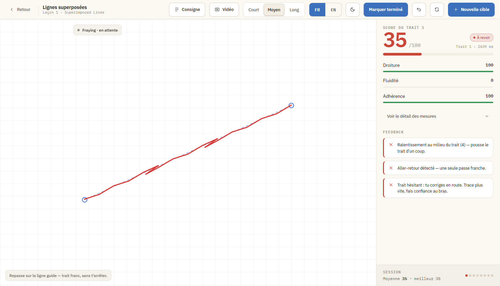
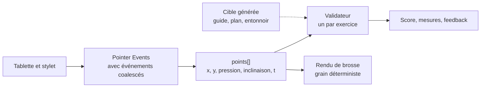

# HowDrawaBox

**Sur la même ligne guide, un trait franc de 214 ms obtient 77/100 et un trait hésitant de 2,6 s en obtient 35. Le dessin final est presque identique, c'est le geste qui est noté.**

Un entraîneur de dessin basé sur le cursus [Drawabox](https://drawabox.com). Chaque point du trait est capturé (position, pression, inclinaison du stylet, horodatage) et évalué géométriquement pendant que tu traces. JavaScript pur, sans aucune dépendance.




## Le problème

Drawabox ne juge pas la ressemblance d'un dessin, mais **la qualité du geste** : un trait se trace d'un mouvement franc, sans s'arrêter pour corriger. Or une fois le dessin rendu en image, cette information a disparu. Un correcteur qui analyse l'image finale ne peut donc pas enseigner Drawabox.

La démonstration, mesurée dans l'application sur la même ligne guide :

| | Trait franc | Trait hésitant |
|---|---:|---:|
| Durée | 214 ms | 2 639 ms |
| Droiture | 100 | 100 |
| Adhérence à la ligne | 100 | 100 |
| Fluidité | 100 | **0** |
| **Score** | **77/100** | **35/100** |

Droiture et adhérence sont identiques : seule la dynamique sépare les deux traits. L'application nomme aussi les fautes du second : *« Aller-retour détecté — une seule passe franche »*.

Ces traits ont été générés par une souris automatisée, avec trop peu de points pour un vrai geste. C'est pourquoi le trait franc perd lui aussi des points sur un « ralentissement ». Ils illustrent le mécanisme, sans étalonner les scores.

**D'où le choix d'architecture :** un canvas web sur mesure plutôt que GIMP ou Krita, qui n'exposent que l'image rendue et jamais la dynamique du geste.

## Comment ça marche



Le contrat de validation ne dépend pas de l'interface : chaque validateur est un module isolé, testable sans navigateur.

```js
// entrée : les points bruts du trait et la cible de l'exercice
points[] = { x, y, pressure, tiltX, tiltY, t }

// sortie
{ score: 0..1, metrics: { /* mesures brutes */ }, feedback: [{ t, m }] }
```

## Ce que mesurent les validateurs

Six modules de validation, plus une primitive partagée pour les ellipses, couvrent 16 exercices :

| Module | Exercices | Mesures |
|---|---|---|
| `superimposed-lines` | Lignes superposées | Écart à la droite, fraying, superposition des passages |
| `ghosted-lines` | Lignes fantômées | Erreur de départ et d'arrivée, arc, dépassement, tremblement |
| `ghosted-planes` | Plans fantômés | Adhérence au guide, bord le plus raté |
| `ellipses-in-planes` | Ellipses en plans, tables d'ellipses | Écart au fit par moindres carrés, nombre de tours, écart aux 4 bords |
| `funnels` | Entonnoirs | Alignement sur l'axe mineur, inscription dans les bornes |
| `markmaking` | Perspectives, boîtes, arêtes | Convergence vers le point de fuite, droiture, fluidité |

Trois signaux s'ajoutent à toutes les analyses, et ce sont eux qui séparent les deux traits ci-dessus : la vitesse, les ralentissements et les aller-retours.

**45 tests sur tracés synthétiques**, chaque règle étant couverte par un tracé bon et un mauvais. Ajouter un exercice noté revient à écrire un module de validation et une entrée dans `MODES`.

## L'application

- **Cours** : leçons du cursus, avec verrouillage progressif et échauffements tirés au sort.
- **Challenges** : les 5 séries longues, comme les 250 boîtes.
- **Exercices** : 16 exercices notés en direct.
- **Anatomie** et **Dessin libre** : sans notation, avec références photo et vidéo flottantes.
- **Outil de dessin** : 5 brosses distinctes, gomme au trait entier. Le grain est déterministe, sinon chaque trait scintillerait à chaque rafraîchissement.
- **Progression persistée** et interface bilingue français-anglais.

## Démarrage

Un serveur local est nécessaire, car `file://` bloque `fetch` et les modules ES.

```bash
npm start     # http://localhost:8000
```

```bash
npm test      # 45 tests, sans navigateur
```

**Le contenu du cours n'est pas dans ce dépôt** : il reste la propriété de Drawabox Art Instruction Inc. Sans lui, l'application affiche un message explicite à la place du parcours, mais le moteur d'analyse reste entièrement testable. Le cours est gratuit : **[drawabox.com](https://drawabox.com)**.

<details>
<summary>Schéma attendu de <code>drawabox.json</code></summary>

```jsonc
{ "source": "...", "scraped_at": "...", "lesson_count": 13,
  "exercises": [
    { "id": "...", "lesson": 1, "name": "superimposedlines",
      "title": "...", "url": "...", "images": [], "markdown": "..." }
  ],
  "lessons": [
    { "id": "1", "part": "part1", "part_name": "...", "title": "...",
      "exercises": [ { "id": "...", "title": "...", "url": "..." } ],
      "pages": [ { "page": 1, "section": "...", "images": [], "markdown": "..." } ] }
  ] }
```
</details>

## Structure

```
src/canvas/       capture des Pointer Events, rendu et brosses
src/validators/   le cœur : un module par critère, primitives, tracés de test
src/content/      chargement du contenu, progression
src/ui/           vues, modes d'exercice, références flottantes, thèmes
server.mjs        serveur de développement, sans cache
```

## Limites

- **Seuils non calibrés.** Les critères sont testés, mais leurs seuils restent empiriques et n'ont pas été validés sur de vrais tracés annotés. Un score indique la régularité du geste et ne remplace pas [le retour de la communauté Drawabox](https://drawabox.com/lesson/0/2/critique).
- **Testé sur des tracés synthétiques.** Les 45 tests vérifient la logique, pas la pertinence pédagogique ressentie par un élève.
- **Pas de démo en ligne**, puisque le contenu du cours ne peut pas être redistribué.

## Suite

- Calibrer les seuils sur des tracés réels annotés.
- Compléter les règles géométriques par un retour qualitatif.

## Crédits

Cursus, texte pédagogique et images : **[Drawabox](https://drawabox.com)**, © Drawabox Art Instruction Inc. Série « Anatomy Quick Tips » : **[Sinix Design](https://www.youtube.com/@sinixdesign)**, lue via l'intégration YouTube officielle.

Le code est sous [licence MIT](LICENSE), qui ne couvre pas le contenu pédagogique. Projet personnel, sans but lucratif.
